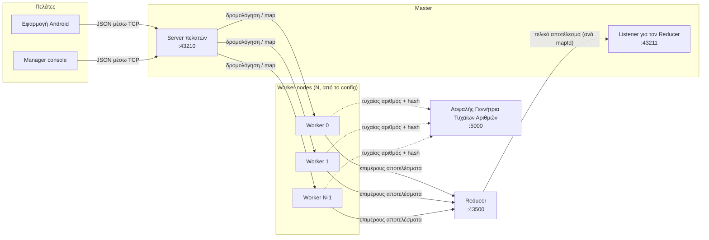
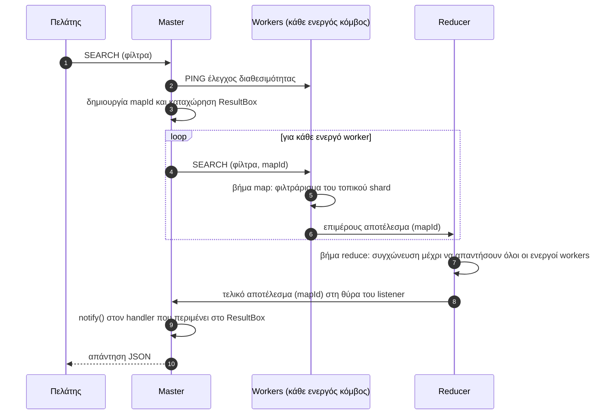
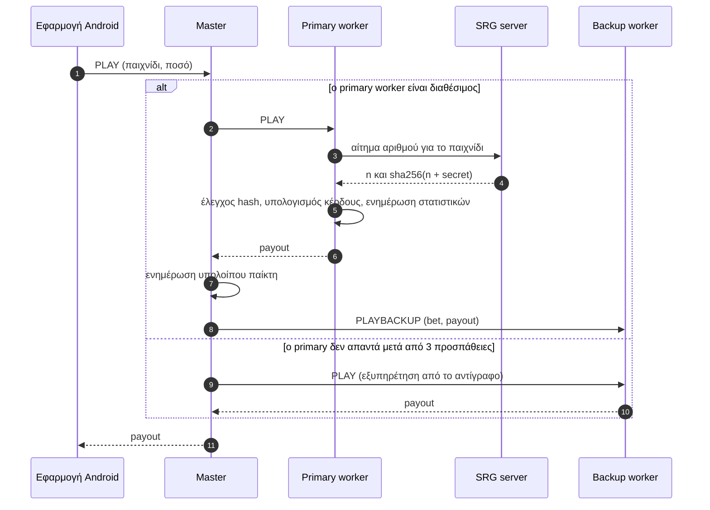

<div align="center">

# GoldenBet

**Κατανεμημένη πλατφόρμα online παιχνιδιών, χτισμένη πάνω σε δική μας μηχανή MapReduce, με native εφαρμογή Android.**


</div>

Το GoldenBet είναι μια πλατφόρμα παιχνιδιών τύπου καζίνο, το backend της οποίας εκτελείται σε πολλά μηχανήματα. Οι managers δημοσιεύουν και διαχειρίζονται παιχνίδια από μια console εφαρμογή. Οι παίκτες βλέπουν, φιλτράρουν, παίζουν και βαθμολογούν αυτά τα παιχνίδια από μια εφαρμογή Android. Τα δεδομένα των παιχνιδιών κατανέμονται σε worker nodes και κάθε ερώτημα απαντάται από μια pipeline **MapReduce** γραμμένη από το μηδέν. Τα αποτελέσματα των πονταρισμάτων προέρχονται από έναν ξεχωριστό server **Ασφαλούς Γεννήτριας Τυχαίων Αριθμών (SRG)**, οι αριθμοί του οποίου επαληθεύονται με SHA-256. Επιπλέον, κάθε παιχνίδι **αντιγράφεται (replication)**, ώστε η πλατφόρμα να συνεχίζει να λειτουργεί όταν πέσει ένας worker node.

Όλα είναι υλοποιημένα από τις βάσεις: σκέτο networking με `ServerSocket`/`Socket`, `synchronized` + `wait()/notify()` για τον συντονισμό και δομές δεδομένων στη μνήμη. Χωρίς frameworks, χωρίς primitives του `java.util.concurrent`, χωρίς βάση δεδομένων.

> **Σημείωση:** Το GoldenBet είναι ακαδημαϊκό project. Χρησιμοποιεί εικονικό νόμισμα (**FUN** tokens). Δεν εμπλέκονται πραγματικά χρήματα και όλες οι πληρωμές είναι προσομοιωμένες.

---

## Περιεχόμενα

- [GoldenBet](#goldenbet)
  - [Περιεχόμενα](#περιεχόμενα)
  - [Κύρια σημεία](#κύρια-σημεία)
  - [Αρχιτεκτονική συστήματος](#αρχιτεκτονική-συστήματος)
  - [Πώς λειτουργεί](#πώς-λειτουργεί)
    - [Τοποθέτηση παιχνιδιών](#τοποθέτηση-παιχνιδιών)
    - [Ερωτήματα MapReduce](#ερωτήματα-mapreduce)
    - [Ποντάρισμα](#ποντάρισμα)
    - [Υπολογισμός κέρδους](#υπολογισμός-κέρδους)
    - [Ανοχή σε σφάλματα (active replication)](#ανοχή-σε-σφάλματα-active-replication)
    - [Μοντέλο ταυτοχρονισμού](#μοντέλο-ταυτοχρονισμού)
  - [Λειτουργίες](#λειτουργίες)
    - [Manager console](#manager-console)
    - [Εφαρμογή Android](#εφαρμογή-android)
  - [Κάλυψη απαιτήσεων εργασίας](#κάλυψη-απαιτήσεων-εργασίας)
    - [Πέρα από την εκφώνηση](#πέρα-από-την-εκφώνηση)
  - [Τεχνολογίες](#τεχνολογίες)
  - [Δομή του project](#δομή-του-project)
  - [Εγκατάσταση και εκτέλεση](#εγκατάσταση-και-εκτέλεση)
    - [Προαπαιτούμενα](#προαπαιτούμενα)
    - [1. Ρύθμιση δικτύου](#1-ρύθμιση-δικτύου)
    - [2. Build του backend](#2-build-του-backend)
    - [3. Εκκίνηση του backend](#3-εκκίνηση-του-backend)
    - [4. Εκκίνηση του Manager console και προσθήκη παιχνιδιών](#4-εκκίνηση-του-manager-console-και-προσθήκη-παιχνιδιών)
    - [5. Εκτέλεση της εφαρμογής Android](#5-εκτέλεση-της-εφαρμογής-android)
  - [Μορφή περιγραφής παιχνιδιού](#μορφή-περιγραφής-παιχνιδιού)
  - [Πρωτόκολλο επικοινωνίας](#πρωτόκολλο-επικοινωνίας)
  - [Περιορισμοί](#περιορισμοί)
  - [Ομάδα](#ομάδα)

---

## Κύρια σημεία

- **Δική μας μηχανή MapReduce.** Η αναζήτηση, τα στατιστικά, τα leaderboards και το ιστορικό συναλλαγών υπολογίζονται στέλνοντας το αίτημα σε κάθε worker (map) και συγχωνεύοντας τα επιμέρους αποτελέσματα σε έναν ξεχωριστό Reducer (reduce).
- **Sharding με hashing.** Κάθε παιχνίδι βρίσκεται στον worker `H(GameName) mod N`. Ο αριθμός των workers είναι αυθαίρετος και ορίζεται σε αρχείο ρυθμίσεων.
- **Επαληθεύσιμη τυχαιότητα.** Ένας αυτόνομος, πολυνηματικός SRG server παράγει εκ των προτέρων αριθμούς για κάθε παιχνίδι σε έναν buffer περιορισμένης χωρητικότητας (producer–consumer). Υπογράφει κάθε αριθμό με `sha256(number + secret)` και ο worker ελέγχει αυτό το hash πριν χρησιμοποιήσει τον αριθμό.
- **Ανοχή σε σφάλματα (bonus).** Κάθε παιχνίδι έχει ένα primary και ένα backup αντίγραφο σε διαφορετικούς κόμβους. Όταν ένας κόμβος πέσει, ο Master το εντοπίζει, δρομολογεί τα αιτήματα στο αντίγραφο και ενημερώνει τον Reducer να περιμένει μία απάντηση λιγότερη.
- **Πλήρης εφαρμογή Android.** Λογαριασμοί, πορτοφόλι, αναζήτηση με φίλτρα, τρεις τύποι παιχνιδιών με animation (slots, τροχός, πόκερ), βαθμολογίες, ιστορικό, προσωπικά στατιστικά, live leaderboard, dark mode και μετάφραση σε αγγλικά/ελληνικά.

---

## Αρχιτεκτονική συστήματος



| Component | Σημείο εκκίνησης | Ρόλος |
|---|---|---|
| **Master** | [`Master.Master`](backend/src/main/java/Master/Master.java) | Μοναδικό σημείο εισόδου για όλους τους πελάτες. Ξεκινά ένα handler thread ανά σύνδεση, δρομολογεί αιτήματα στους workers, εκτελεί τις εργασίες MapReduce και αποθηκεύει τους λογαριασμούς, τα υπόλοιπα και τις καταθέσεις των παικτών. |
| **Worker** | [`Worker.Worker <index>`](backend/src/main/java/Worker/Worker.java) | Κρατά στη μνήμη το κομμάτι (shard) των παιχνιδιών που του αντιστοιχεί (primary και backup αντίγραφα), εκτελεί τα πονταρίσματα, ενημερώνει τα στατιστικά και εκτελεί το βήμα *map* κάθε ερωτήματος. |
| **Reducer** | [`reducer.Reducer`](backend/src/main/java/reducer/Reducer.java) | Συλλέγει τα επιμέρους αποτελέσματα ανά `mapId`, τα συγχωνεύει (λίστες ή αθροισμένα maps) και στέλνει το τελικό αποτέλεσμα πίσω στον Master. |
| **SRG server** | [`generator.SRGServer`](backend/src/main/java/generator/SRGServer.java) | Ένα producer thread ανά παιχνίδι γεμίζει έναν buffer περιορισμένης χωρητικότητας με αριθμούς από `SecureRandom`, οι οποίοι σερβίρονται στους workers μαζί με μια υπογραφή SHA-256. |
| **Manager console** | [`Manager.ManagerApp`](backend/src/main/java/Manager/ManagerApp.java) | CLI διαχειριστή: προσθήκη, αφαίρεση και τροποποίηση παιχνιδιών, προβολή του καταλόγου και αναφορές κερδών/ζημιών. |
| **Εφαρμογή Android** | [`android/`](android/) | Η εφαρμογή των παικτών. |

---

## Πώς λειτουργεί

### Τοποθέτηση παιχνιδιών

Όταν ο manager προσθέτει ένα παιχνίδι, ο Master κάνει hash το όνομά του για να επιλέξει τον **primary** worker και χρησιμοποιεί τον επόμενο κόμβο ως **backup**:

```text
primary = |hash(GameName)| mod N
backup  = (primary + 1) mod N
```

Και οι δύο κόμβοι αποθηκεύουν το παιχνίδι. Το backup αντίγραφο έχει τη σημαία `backUp = true` και δεν εμφανίζεται ποτέ στα αποτελέσματα ερωτημάτων όσο ο primary λειτουργεί, οπότε τίποτα δεν μετράται δύο φορές.

### Ερωτήματα MapReduce

Κάθε ανάγνωση που αφορά ολόκληρο τον κατάλογο ακολουθεί την ίδια pipeline: αναζήτηση, αναφορές του manager, leaderboard, ιστορικό και οι λίστες ενεργών ή όλων των παιχνιδιών.



Ο Reducer χρησιμοποιεί διαφορετικό aggregation box για κάθε τύπο ερωτήματος:

| Box | Χρήση | Τρόπος συγχώνευσης |
|---|---|---|
| `GameListBox` | αναζήτηση, ενεργά παιχνίδια, όλα τα παιχνίδια | συνένωση λιστών |
| `StatsMapBox` | κέρδη/ζημιές ανά παιχνίδι, ανά πάροχο, ανά παίκτη | άθροιση τιμών ανά κλειδί |
| `TransactionListBox` | ιστορικό παίκτη | συνένωση λιστών (στη συνέχεια ο Master προσθέτει τις δικές του εγγραφές καταθέσεων και ταξινομεί από το πιο πρόσφατο) |

### Ποντάρισμα



Ο backup δεν τραβάει ποτέ δικό του τυχαίο αριθμό. Λαμβάνει από τον Master το ακριβές ζεύγος `(bet, payout)`, ώστε και τα δύο αντίγραφα να καταγράφουν το ίδιο αποτέλεσμα.

### Υπολογισμός κέρδους

Όταν ένας worker λάβει έναν επαληθευμένο τυχαίο ακέραιο `r`:

```text
if r mod 100 == 0  ->  payout = bet × jackpot
else               ->  payout = bet × multipliers[r mod 10]
```

| Επίπεδο ρίσκου | Πολλαπλασιαστές (θέση 0 → 9) | Jackpot |
|---|---|---|
| Χαμηλό (low) | `0.0 0.0 0.0 0.1 0.5 1.0 1.1 1.3 2.0 2.5` | ×10 |
| Μεσαίο (medium) | `0.0 0.0 0.0 0.0 0.0 0.5 1.0 1.5 2.5 3.5` | ×20 |
| Υψηλό (high) | `0.0 0.0 0.0 0.0 0.0 0.0 0.0 1.0 2.0 6.5` | ×40 |

Μετά από κάθε ποντάρισμα ο worker ενημερώνει το **κέρδος του παιχνιδιού** (`+ bet − payout`, από τη σκοπιά της πλατφόρμας) και το **κέρδος του παίκτη** (`+ payout − bet`). Αποθηκεύει επίσης δύο συναλλαγές (`GAME_BET`, `GAME_RESULT`) για το ιστορικό του παίκτη. Πονταρίσματα εκτός του εύρους `[MinBet, MaxBet]` του παιχνιδιού απορρίπτονται στον server.

### Ανοχή σε σφάλματα (active replication)

| Θέμα | Μηχανισμός |
|---|---|
| **Συγχρονισμός αντιγράφων** | Οι λειτουργίες προσθήκης, αφαίρεσης, τροποποίησης και βαθμολόγησης εφαρμόζονται στον primary και στη συνέχεια προωθούνται στον backup. Τα πονταρίσματα εκτελούνται μία φορά στον primary και αντιγράφονται στον backup μέσω `PLAYBACKUP`. |
| **Εντοπισμός σφαλμάτων** | Κάθε κλήση Master → Worker επαναλαμβάνεται έως 3 φορές, με 1 s διαφορά. Πριν από κάθε εργασία MapReduce ο Master κάνει ping σε όλους τους workers. Ένας worker που δεν απαντά σημειώνεται ως ανενεργός. |
| **Failover για αιτήματα ενός παιχνιδιού** | Τα αιτήματα για τα παιχνίδια ενός worker που έπεσε δρομολογούνται στον backup κόμβο του. |
| **Failover για MapReduce** | Ο backup κόμβος ενημερώνεται να συμπεριλάβει τα backup δεδομένα του στο βήμα map. Ο Master ειδοποιεί τον Reducer (μέσω του backup worker) με `WORKER_FAILURE`, ώστε να περιμένει μία απάντηση λιγότερη. |
| **Χρήση των backup μόνο όταν χρειάζεται** | Τα backup αντίγραφα εξαιρούνται από κάθε ερώτημα, εκτός αν ο primary τους έχει πέσει. |

### Μοντέλο ταυτοχρονισμού

Κάθε server (Master, Worker, Reducer, SRG) ξεκινά ένα thread για κάθε εισερχόμενη σύνδεση. Η κοινόχρηστη κατάσταση προστατεύεται **μόνο** με `synchronized` και `wait()/notify()`:

- **Master:** ο πίνακας `mapId → ResultBox` είναι synchronized. Κάθε client handler thread κάνει `wait()` στο δικό του box, και το thread του reducer listener του κάνει `notify()` όταν φτάσει το τελικό αποτέλεσμα.
- **Workers:** ο κατάλογος παιχνιδιών, τα κέρδη ανά παιχνίδι, τα κέρδη ανά παίκτη και τα logs συναλλαγών προστατεύονται με μπλοκ `synchronized`. Έτσι, ταυτόχρονα πονταρίσματα στο ίδιο παιχνίδι από διαφορετικούς παίκτες καταμετρώνται σωστά.
- **Reducer:** ο buffer αποτελεσμάτων ανά `mapId` και τα aggregation boxes είναι synchronized.
- **SRG:** κλασικό μοντέλο producer–consumer με buffer περιορισμένης χωρητικότητας. Ο producer μπλοκάρει όσο ο buffer είναι γεμάτος και οι consumers μπλοκάρουν όσο είναι άδειος (`wait()` / `notifyAll()`).

---

## Λειτουργίες

### Manager console

| # | Ενέργεια | Σημειώσεις |
|---|---|---|
| 1 | Προβολή παιχνιδιών | Όλα τα παιχνίδια, ενεργά και αφαιρεμένα, με την κατάστασή τους |
| 2 | Προσθήκη παιχνιδιού | Επιλογή αρχείου JSON και κατηγορίας παιχνιδιού (`FRUIT` / `WHEEL` / `POKER`). Το λογότυπο κωδικοποιείται σε Base64 και αποστέλλεται μαζί με το παιχνίδι. |
| 3 | Αφαίρεση παιχνιδιού | Soft delete: οι παίκτες δεν βλέπουν πλέον το παιχνίδι, αλλά τα στατιστικά του παραμένουν σε όλες τις αναφορές. Αν το παιχνίδι προστεθεί ξανά, ενεργοποιείται πάλι. |
| 4 | Τροποποίηση παιχνιδιού | Πάροχος, επίπεδο ρίσκου, ελάχιστο/μέγιστο ποντάρισμα, διαδρομή λογοτύπου. Η κατηγορία πονταρίσματος, το jackpot και οι πολλαπλασιαστές υπολογίζονται ξανά αυτόματα. |
| 5 | Κέρδη/ζημιές ανά παιχνίδι | MapReduce |
| 6 | Κέρδη/ζημιές ανά παίκτη (όλοι) | MapReduce |
| 7 | Κέρδη/ζημιές για έναν παίκτη | MapReduce |
| 8 | Κέρδη/ζημιές ανά πάροχο | MapReduce, μία γραμμή για κάθε παιχνίδι του παρόχου |

### Εφαρμογή Android

- **Λογαριασμός:** εγγραφή, σύνδεση και αποσύνδεση, και επεξεργασία προφίλ (όνομα, e-mail, τηλέφωνο, διεύθυνση και φωτογραφία από την κάμερα ή τη συλλογή).
- **Πορτοφόλι:** κατάθεση FUN με επιλογή τρόπου πληρωμής και κουμπιά γρήγορων ποσών (προσομοίωση). Το υπόλοιπο τηρείται στον server.
- **Αναζήτηση:** αναζήτηση με slider εύρους αστεριών και chips πολλαπλής επιλογής για την κατηγορία πονταρίσματος (`$`, `$$`, `$$$`) και το επίπεδο ρίσκου. Το φιλτράρισμα γίνεται στον server μέσω MapReduce, με επιπλέον άμεση αναζήτηση κειμένου με βάση το όνομα, pull-to-refresh και ταξινόμηση των αποτελεσμάτων κατά βαθμολογία.
- **Παιχνίδι:** τρεις εμπειρίες παιχνιδιού, ανάλογα με την κατηγορία του παιχνιδιού:
  - **Fruit slots:** πλέγμα 3×3 με θεματικά σύμβολα ανά παιχνίδι και γραμμές κέρδους.
  - **Τροχός:** περιστρεφόμενος τροχός του οποίου τα κομμάτια αντιστοιχούν στον πίνακα ρίσκου του παιχνιδιού.
  - **Πόκερ:** μοιρασμένο χέρι 5 φύλλων, η δύναμη του οποίου αντιστοιχεί στον πολλαπλασιαστή.

  Το αποτέλεσμα το αποφασίζει πάντα το backend. Η εφαρμογή απλώς κάνει animation τον πολλαπλασιαστή που επιστρέφεται, με ήχους νίκης και ήττας.
- **Βαθμολόγηση:** 1–5 αστέρια με βήμα μισού αστεριού. Μπορείτε να βαθμολογήσετε μόνο παιχνίδια που έχετε παίξει.
- **Ιστορικό:** πονταρίσματα, κέρδη και καταθέσεις με chips φίλτρων και αναζήτηση κειμένου, με τα πιο πρόσφατα πρώτα.
- **Στατιστικά:** συνολικά κέρδη/ζημιές, ποσοστό νικών, μέσο κέρδος ανά ποντάρισμα, μέσο ποσό νίκης, μέση ζημιά, μεγαλύτερο κέρδος, το παιχνίδι που παίχτηκε περισσότερο και γράφημα εβδομαδιαίας δραστηριότητας.
- **Leaderboard:** οι 5 κορυφαίοι παίκτες στην αρχική οθόνη, καθώς και πλήρες leaderboard που ανανεώνεται κάθε 15 δευτερόλεπτα όσο είναι ανοιχτό.
- **Ρυθμίσεις:** σκούρο ή ανοιχτό θέμα, αγγλικά ή ελληνικά.

Η εφαρμογή ακολουθεί αρχιτεκτονική **MVP** (ένα View interface και ένας Presenter ανά οθόνη) με ViewBinding. Ένα ViewModel διατηρεί τη συνεδρία κατά τις αλλαγές διαμόρφωσης (configuration changes). Όλη η επικοινωνία μέσω sockets τρέχει σε background threads και τα αποτελέσματα επιστρέφονται στο UI thread, ώστε η εφαρμογή να παραμένει διαδραστική όσο περιμένει τον Master.

---

## Κάλυψη απαιτήσεων εργασίας

<details>
<summary><b>Αντιστοίχιση απαιτήσεων → υλοποίησης</b></summary>

| Απαίτηση | Υλοποίηση |
|---|---|
| Πολυνηματικός TCP Master μόνο με `ServerSocket` | [`Master`](backend/src/main/java/Master/Master.java), [`MasterHandler`](backend/src/main/java/Master/MasterHandler.java) |
| Workers που ορίζονται κατά την εκκίνηση από arguments/config, σε οποιονδήποτε αριθμό | [`system_network_config.conf`](backend/src/main/resources/system_network_config.conf), [`ConfigLoader`](backend/src/main/java/utils/ConfigLoader.java) |
| Τοποθέτηση παιχνιδιών με `H(GameName) mod N` | `MasterHandler.hashGameToWorker` |
| Αναζήτηση μέσω MapReduce | Worker `searchGames` (map) → Reducer `GameListBox` (reduce) |
| Κέρδη/ζημιές ανά πάροχο και ανά παίκτη μέσω MapReduce | `PROVIDER_GAME_PROFITS`, `PLAYERS_PROFITS` → `StatsMapBox` |
| SRG ως ξεχωριστός πολυνηματικός TCP server με buffer producer–consumer | [`SRGServer`](backend/src/main/java/generator/SRGServer.java), [`RandomNumberGenerator`](backend/src/main/java/generator/RandomNumberGenerator.java) |
| Κοινό secret και επαλήθευση `sha256(number + secret)` | [`GeneratorHandler`](backend/src/main/java/generator/GeneratorHandler.java), `WorkerHandler.getSecuredRandomNumber` |
| Πίνακες ρίσκου, jackpot όταν `r mod 100 == 0` | [`Game`](backend/src/main/java/Models/Game.java), `WorkerHandler.CalculateProfit` |
| Η κατηγορία πονταρίσματος (`$`/`$$`/`$$$`) και το jackpot υπολογίζονται από το σύστημα | `Game.calculateBetCategory`, `Game.setJackpotAndMultipliers` |
| Σωστός χειρισμός ταυτόχρονων πονταρισμάτων | Maps κερδών και συναλλαγών με `synchronized` στον [`WorkerHandler`](backend/src/main/java/Worker/WorkerHandler.java) |
| Τα αφαιρεμένα παιχνίδια κρύβονται από τους παίκτες, αλλά τα στατιστικά τους διατηρούνται | Soft delete (σημαία `active`) |
| Συγχρονισμός μόνο με `synchronized` / `wait` / `notify` | `ResultBox` του Master, buffer του SRG, κατάσταση Worker και Reducer |
| Αποθήκευση μόνο στη μνήμη | Δομές `HashMap` σε κάθε κόμβο |
| Εφαρμογή Android με ασύγχρονη επικοινωνία TCP | [`android/`](android/), background threads με `runOnUiThread` |
| **Bonus:** active replication με failover | Τοποθέτηση primary/backup, `PLAYBACKUP`, `PING`, `WORKER_FAILURE` |

</details>

### Πέρα από την εκφώνηση

Τα παρακάτω προστέθηκαν επιπλέον της αρχικής εκφώνησης:

- Λογαριασμοί παικτών (εγγραφή, σύνδεση, προφίλ με φωτογραφία) και **πορτοφόλι στον server** με ιστορικό καταθέσεων
- **Ιστορικό συναλλαγών** που απαντάται μέσω MapReduce και συγχωνεύεται με τις καταθέσεις που κρατά ο Master
- **Πίνακας προσωπικών στατιστικών** και **live leaderboard**
- **Τρεις τύποι παιχνιδιών με animation** και ήχο, αντί για μία γενική ενέργεια «παίξε»
- Λογότυπα παιχνιδιών που μεταφέρονται από άκρη σε άκρη ως Base64 (Manager → Master → Workers → Android)
- Soft delete και επανενεργοποίηση παιχνιδιών, προβολή ολόκληρου του καταλόγου μαζί με τα αφαιρεμένα παιχνίδια, και κέρδη/ζημιές **ανά παιχνίδι**
- Έλεγχοι διαθεσιμότητας των workers και επαναλήψεις αιτημάτων
- Σκούρο/ανοιχτό θέμα και μετάφραση σε αγγλικά/ελληνικά

---

## Τεχνολογίες

| Επίπεδο | Τεχνολογίες |
|---|---|
| Backend | Java 17, Maven, σκέτα TCP sockets (`ServerSocket`, `Object*Stream`), Gson, org.json |
| Android | Java, Android SDK 36 (ελάχιστο 26), AndroidX, Material Components, ViewBinding, Gson |
| Build | Maven (backend), Gradle 8.13 / AGP 8.13 (Android) |

---

## Δομή του project

```text
GoldenBet/
├── backend/                          # Κατανεμημένο backend (Maven)
│   ├── pom.xml
│   └── src/main/
│       ├── java/
│       │   ├── Master/               # Master server, client handler, ResultBox
│       │   ├── Worker/               # Worker node και handler αιτημάτων
│       │   ├── reducer/              # Reducer και aggregation boxes
│       │   ├── generator/            # Server Ασφαλούς Γεννήτριας Τυχαίων Αριθμών (SRG)
│       │   ├── Manager/              # Console εφαρμογή του manager
│       │   ├── Player/               # Dummy client παίκτη της Φάσης Α (αντικαταστάθηκε από την εφαρμογή Android)
│       │   ├── Client/               # Βοηθητικοί TCP clients
│       │   ├── Models/               # Κοινό domain model και τύποι μηνυμάτων
│       │   └── utils/                # ConfigLoader
│       └── resources/
│           ├── system_network_config.conf
│           ├── games/                # Περιγραφές παιχνιδιών (JSON)
│           └── logos/                # Λογότυπα παιχνιδιών
└── android/                          # Εφαρμογή Android (Gradle)
    └── app/src/main/
        ├── assets/master_network_config.conf
        ├── java/gr/goldenbet/
        │   ├── domain/               # Models και κανόνες των mini-games (slots, τροχός, πόκερ)
        │   ├── utils/                # ConfigLoader, βοηθητικά για εικόνες
        │   └── view/                 # Οθόνες MVP: login, register, mainMenu, games, settings
        └── res/                      # Layouts, drawables, ήχοι, strings EN/EL
```

---

## Εγκατάσταση και εκτέλεση

### Προαπαιτούμενα

- **JDK 17+**
- **Maven 3.8+** (ή IntelliJ IDEA, που περιλαμβάνει ενσωματωμένο Maven)
- **Android Studio** με Android SDK 36, καθώς και συσκευή ή emulator με Android 8.0 (API 26) ή νεότερο

### 1. Ρύθμιση δικτύου

Όλα τα components του backend διαβάζουν το [`backend/src/main/resources/system_network_config.conf`](backend/src/main/resources/system_network_config.conf). Κάθε γραμμή έχει τη μορφή `ROLE:IP:PORT`:

```properties
MASTER:127.0.0.1:43210
MASTER_REDUCER_LISTENER:127.0.0.1:43211
REDUCER:127.0.0.1:43500
SRG:127.0.0.1:5000

# μία γραμμή ανά worker, προσθέστε όσους θέλετε
WORKER:127.0.0.1:5001
WORKER:127.0.0.1:5002
WORKER:127.0.0.1:5003
```

- Για να τρέξουν όλα σε **ένα μηχάνημα**, χρησιμοποιήστε `127.0.0.1`.
- Για **πραγματική κατανεμημένη εγκατάσταση**, χρησιμοποιήστε τη LAN IP κάθε μηχανήματος και βάλτε το ίδιο αρχείο σε όλα τα μηχανήματα.
- Ο δείκτης (index) ενός worker είναι η θέση του ανάμεσα στις γραμμές `WORKER`, ξεκινώντας από το `0`.

Οι servers ακούνε σε όλα τα network interfaces. Οι IP του αρχείου απλώς λένε σε κάθε component πού θα βρει τα υπόλοιπα.

### 2. Build του backend

```bash
cd backend
```

```bash
mvn compile
```

### 3. Εκκίνηση του backend

Ξεκινήστε κάθε component σε δικό του terminal, **από τον φάκελο `backend/`** (οι διαδρομές του config είναι σχετικές με αυτόν), με την εξής σειρά:

**SRG server**
```bash
mvn -q exec:java "-Dexec.mainClass=generator.SRGServer"
```

**Reducer**
```bash
mvn -q exec:java "-Dexec.mainClass=reducer.Reducer"
```

**Workers:** ξεκινήστε έναν για κάθε γραμμή `WORKER`, δίνοντας τον δείκτη του (`0`, `1`, `2`, …)
```bash
mvn -q exec:java "-Dexec.mainClass=Worker.Worker" "-Dexec.args=0"
```

**Master**
```bash
mvn -q exec:java "-Dexec.mainClass=Master.Master"
```

> **IntelliJ IDEA:** ανοίξτε το `backend/` ως Maven project και τρέξτε τις ίδιες main classes. Κρατήστε το working directory στο `backend/` και ενεργοποιήστε το *Allow multiple instances* στο run configuration του Worker, ώστε να μπορείτε να ξεκινήσετε έναν για κάθε δείκτη.

### 4. Εκκίνηση του Manager console και προσθήκη παιχνιδιών

```bash
mvn -q exec:java "-Dexec.mainClass=Manager.ManagerApp"
```

Επιλέξτε **2. Add game**, διαλέξτε ένα από τα έτοιμα αρχεία στο `resources/games/` και ορίστε του κατηγορία. Ο κατάλογος ξεκινά άδειος σε κάθε εκτέλεση, επειδή όλη η κατάσταση κρατιέται στη μνήμη.

### 5. Εκτέλεση της εφαρμογής Android

1. Ανοίξτε τον φάκελο `android/` στο Android Studio.
2. Ορίστε τη διεύθυνση του Master στο [`android/app/src/main/assets/master_network_config.conf`](android/app/src/main/assets/master_network_config.conf):
   ```properties
   MASTER:<master-ip>:43210
   ```
   - **Emulator στον ίδιο υπολογιστή:** `10.0.2.2`
   - **Φυσική συσκευή:** η LAN IP του μηχανήματος του Master. Το κινητό πρέπει να είναι στο ίδιο δίκτυο και το firewall να επιτρέπει εισερχόμενες συνδέσεις TCP στη θύρα `43210`.
3. Τρέξτε το configuration `app`.

**Demo λογαριασμοί** (δημιουργούνται στη μνήμη όταν ξεκινά ο Master): `gpap123` / `pass1234` και `vas` / `vas`. Μπορείτε επίσης να εγγράψετε νέο λογαριασμό από την εφαρμογή.

---

## Μορφή περιγραφής παιχνιδιού

Για να προσθέσει ένα παιχνίδι, ο manager δίνει ένα αρχείο JSON και ένα λογότυπο:

```json
{
  "GameName": "Fruit Fiesta",
  "ProviderName": "FruitSlots",
  "Stars": 5,
  "NoOfVotes": 12,
  "GameLogo": "src/main/resources/logos/fruit_fiesta_logo.webp",
  "MinBet": 0.1,
  "MaxBet": 60,
  "RiskLevel": "low",
  "HashKey": "Fruit_Fiesta_secret_11"
}
```

- Το `GameLogo` είναι διαδρομή σχετική με τον φάκελο `backend/`.
- Το `HashKey` είναι το secret που μοιράζονται ο worker και ο SRG και χρησιμοποιείται για την υπογραφή των τυχαίων αριθμών.
- Το `RiskLevel` παίρνει τις τιμές `low`, `medium` ή `high`.
- Η **κατηγορία πονταρίσματος**, το **jackpot** και οι **πολλαπλασιαστές** *δεν* περιλαμβάνονται στο αρχείο. Τα υπολογίζει το σύστημα:

| Ελάχιστο ποντάρισμα | Κατηγορία πονταρίσματος |
|---|---|
| `< 1` FUN | `$` |
| `1 – 4.99` FUN | `$$` |
| `≥ 5` FUN | `$$$` |

<details>
<summary><b>Έτοιμα παιχνίδια-παραδείγματα</b></summary>

| Παιχνίδι | Πάροχος | Ρίσκο | Εύρος πονταρίσματος (FUN) | Κατηγορία |
|---|---|---|---|---|
| Dragon's Lair | MythicBet | low | 5 – 100 | `$$$` |
| Fruit Fiesta | FruitSlots | low | 0.1 – 60 | `$` |
| Gates of Olympus | MythicBet | high | 0.1 – 100 | `$` |
| High Roller Poker | Casino | high | 0.1 – 10 | `$` |
| Lucky Seven | ClassicCasino | low | 1 – 100 | `$$` |
| Pharaoh's Dynasty | MythicBet | medium | 0.1 – 30 | `$` |
| Pirate's Bounty | MythicBet | medium | 1 – 50 | `$$` |

</details>

---

## Πρωτόκολλο επικοινωνίας

Κάθε αίτημα ανοίγει μια νέα σύνδεση TCP, η οποία μένει ανοιχτή μέχρι να φτάσει η απάντηση. Όλα τα μηνύματα έχουν κοινό φάκελο (envelope), το `MasterMessage { type, payload, mapId }`:

- **Πελάτες → Master** (εφαρμογή Android, Manager): ο φάκελος αποστέλλεται ως **JSON string** (Gson) μέσω `ObjectOutputStream`, και η απάντηση είναι επίσης JSON string.
- **Μεταξύ των κόμβων του backend**, ο φάκελος μεταφέρεται ως serialized αντικείμενο Java. Η σύνδεση με έναν worker ξεκινά με ένα handshake `ACK`, ακολουθούμενο από μια σημαία που δηλώνει αν ο worker πρέπει να συμπεριλάβει τα backup δεδομένα του.
- **Worker ↔ SRG**: χρησιμοποιείται ένα μικρό δυαδικό πρωτόκολλο. Η εντολή `1` καταχωρεί ένα παιχνίδι μαζί με το secret του, και η εντολή `0` ζητά έναν αριθμό, ο οποίος επιστρέφεται μαζί με το hash του.

<details>
<summary><b>Τύποι μηνυμάτων</b></summary>

| Χειρισμός | Τύποι |
|---|---|
| Δρομολογούνται στον worker του παιχνιδιού και αντιγράφονται στον backup | `ADD_GAME`, `REMOVE_GAME`, `MODIFY_GAME`, `RATE`, `PLAY` |
| MapReduce σε όλους τους workers | `SEARCH`, `GET_ACTIVE_GAMES`, `GET_ACTIVE_GAMES_FOR_RATE`, `GET_ALL_GAMES`, `GAMES_PROFITS`, `PROVIDER_GAME_PROFITS`, `PLAYERS_PROFITS`, `GET_HISTORY` |
| Εξυπηρετούνται από τον Master | `REGIST`, `LOGIN`, `LOGOUT`, `GET_PLAYER_INFO`, `MODIFY_PLAYER`, `DEPOSIT` |
| Εσωτερικά | `PING`, `PLAYBACKUP`, `WORKER_FAILURE` |

</details>

---

## Περιορισμοί

Το GoldenBet είναι πρωτότυπο για εκπαιδευτικούς σκοπούς, όχι σύστημα παραγωγής:

- **Κατάσταση μόνο στη μνήμη, σκόπιμα.** Η εκφώνηση απαγορεύει τη χρήση βάσης δεδομένων, οπότε η επανεκκίνηση του cluster σβήνει παίκτες, παιχνίδια και στατιστικά.
- **Ο Master είναι μοναδικό σημείο αποτυχίας (single point of failure).** Το replication καλύπτει το επίπεδο των workers: κάθε παιχνίδι επιβιώνει από την απώλεια ενός από τους δύο κόμβους που το φιλοξενούν.
- **Δεν υπάρχει επανένταξη κατά την εκτέλεση.** Ένας worker που σημειώθηκε ως πεσμένος δεν γίνεται ξανά δεκτός. Για να επανέλθει, κάντε επανεκκίνηση του cluster.
- **Χωρίς ασφάλεια μεταφοράς.** Τα διαπιστευτήρια μεταφέρονται και αποθηκεύονται ως απλό κείμενο, χωρίς TLS.
- **Προσομοιωμένες πληρωμές.** Οι καταθέσεις δεν περνούν από κανέναν πάροχο πληρωμών.

---

## Ομάδα

Αναπτύχθηκε από ομάδα τριών φοιτητών του **Τμήματος Πληροφορικής του Οικονομικού Πανεπιστημίου Αθηνών (ΟΠΑ)**, στο πλαίσιο του μαθήματος **Κατανεμημένα Συστήματα** (εαρινό εξάμηνο 2025–2026):

- **Vasilis Mpanos**
- **Giannis Monocholias**
- **Pavlos Gratsanis**
